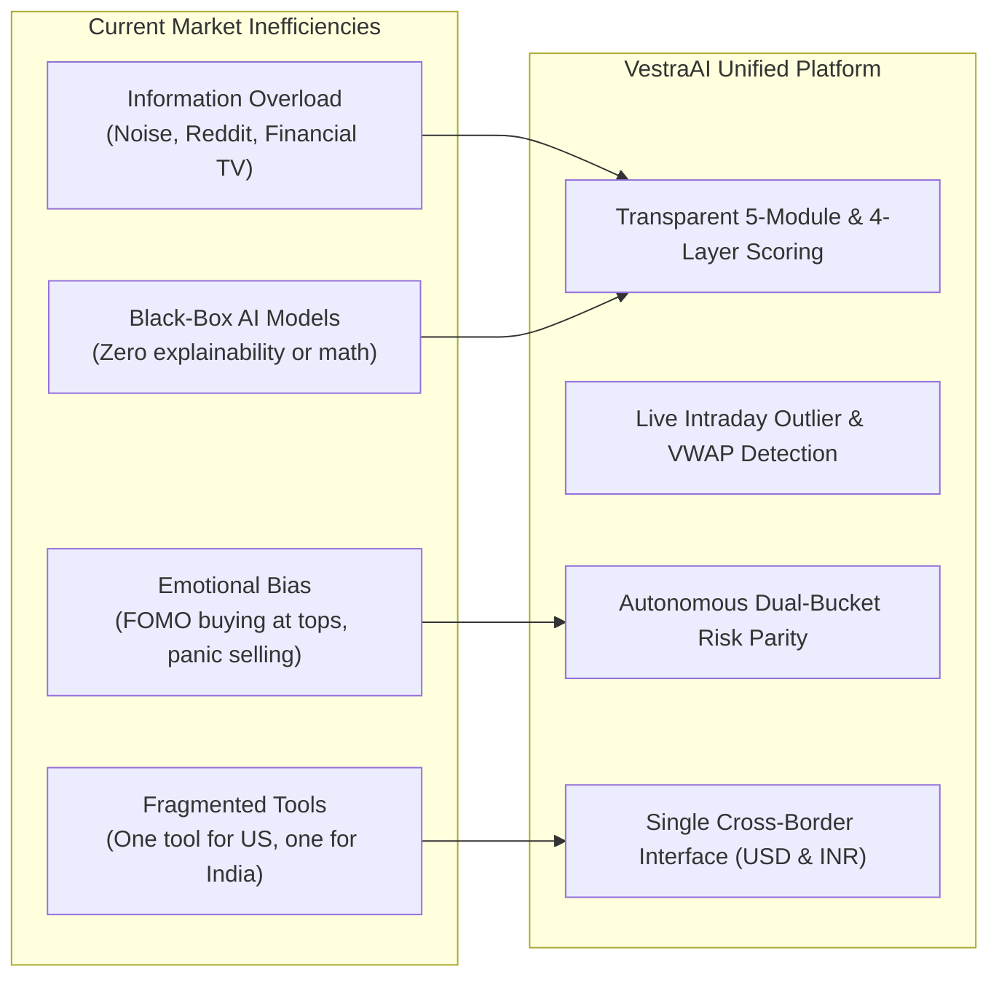
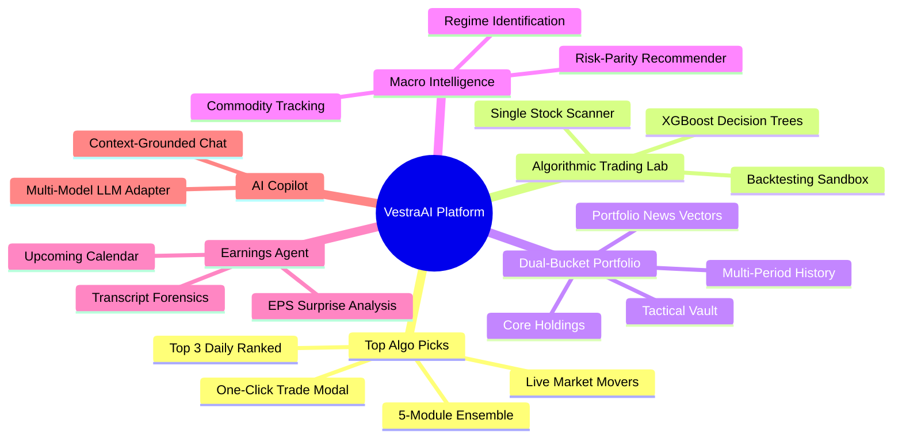
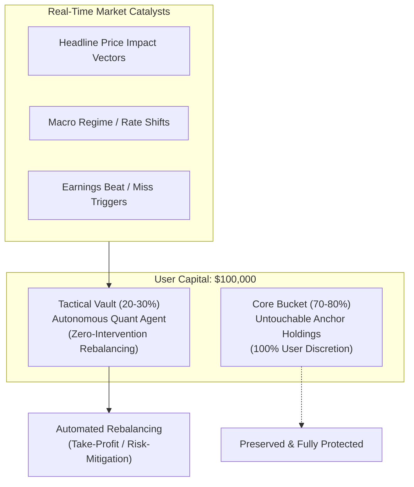
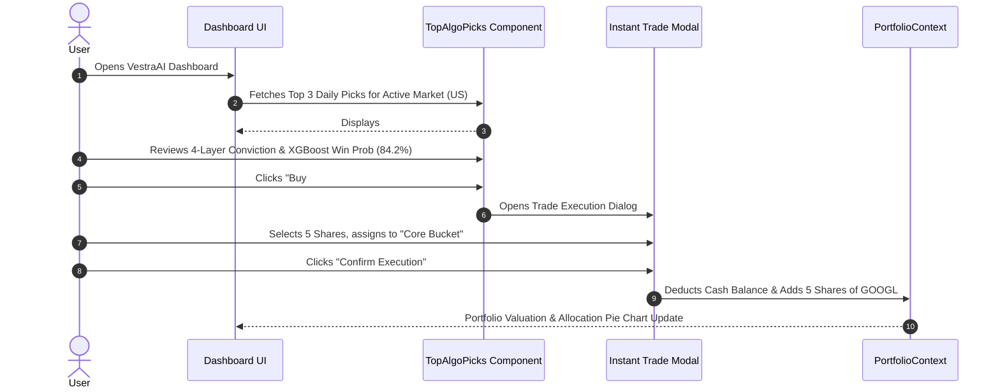
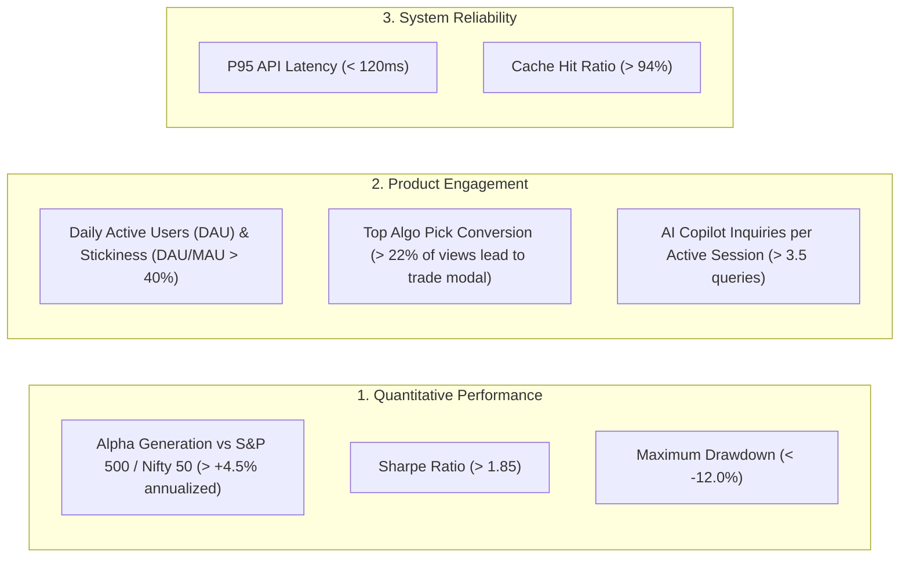

# Product Requirements Document (PRD)
## VestraAI / Satvam Invest: Autonomous Global Investing Intelligence Platform

---

### Document Information
- **Product Name:** VestraAI (Satvam Invest)
- **Document Version:** 1.0.0
- **Document Status:** Complete / Ready for Production Review
- **Owner:** Product Management & Quantitative Strategy Team
- **Target Release:** Q4 2026 - Q1 2027

---

## 1. Executive Summary & Product Vision

### 1.1 Product Vision
**VestraAI** is an AI-native financial intelligence platform that democratizes institutional-grade quantitative investing for modern retail investors, family offices, and active wealth managers. By unifying **US Equities (S&P 500 / NASDAQ)** and **Indian Equities (NSE / NIFTY 50)** into a cohesive, multi-currency command center, VestraAI bridges the gap between complex algorithmic hedge-fund models and accessible, actionable portfolio execution.

### 1.2 Core Value Proposition
- **Institutional Multi-Factor Rigor:** Eliminates emotional trading by evaluating assets through an explainable **5-Module Ensemble Engine** (Factor 35%, XGBoost ML 25%, FinBERT Sentiment 20%, Live VWAP/Momentum 10%, LLM Moat 10%).
- **Live Market Outlier Capture:** Identifies intraday market momentum and breakout volume via real-time **Live Market Movers** screeners.
- **Dual-Bucket Autonomous Portfolio:** Protects long-term wealth through an untouchable **Core Bucket (100% user-directed)** while optimizing opportunistic upside via an autonomous **Tactical Vault (zero-intervention rebalancing)**.
- **Cross-Border Intelligence:** Native dual-currency ($ USD and ₹ INR) engine supporting seamless asset tracking across global markets.

---

## 2. Problem Statement & Market Opportunity

### 2.1 The Retail-Institutional Divide
1. **Information Asymmetry:** Quantitative hedge funds deploy high-frequency sentiment models (FinBERT), alternative data, and low-latency order book analysis. Retail investors rely on lagging quarterly reports and social media hype.
2. **Emotional Execution:** More than 80% of retail traders underperform benchmark indices due to panic-selling during macroeconomic volatility and chasing overbought peaks.
3. **Siloed Ecosystems:** Investors managing portfolios across US and Indian growth stocks must juggle disconnected brokerage platforms, conversions, and news sources without a unified portfolio risk model.

---

## 3. User Personas & Target Demographics

### Persona A: The Systematic Retail Trader ("Arjun")
- **Profile:** 29-year-old software engineer and active equity trader based in Bengaluru / San Francisco.
- **Goals:** Wants data-driven buy signals, clear entry target prices, and probability metrics rather than generic market tips.
- **Pain Point:** Lacks time during market hours to run Python backtests and scan hundreds of stock charts across US and NSE markets.
- **Key Feature Used:** **Top 3 Algo Picks** and **Live Market Movers Scanner**.

### Persona B: The Long-Term Wealth Compounder ("Sarah")
- **Profile:** 42-year-old corporate executive building generational wealth across US Tech leaders and Indian infrastructure.
- **Goals:** Wants capital preservation, strong free cash flow companies, and automated risk management without constant monitoring.
- **Pain Point:** Anxiety over geopolitical shocks and inflation destroying portfolio purchasing power.
- **Key Feature Used:** **Dual-Bucket Portfolio (Core Protected)** and **Macro Intelligence Stream**.

### Persona C: The Fundamental & Macro Allocator ("Devon")
- **Profile:** 35-year-old RIA (Registered Investment Advisor) / Family Office Analyst.
- **Goals:** Requires institutional-grade factor analysis, Put/Call open interest ratios, and transcript forensics to justify allocations to clients.
- **Pain Point:** Traditional Bloomberg / FactSet terminals are prohibitively expensive and lack native generative AI synthesis.
- **Key Feature Used:** **Earnings Agent**, **Algorithmic Trading Lab**, and **AI Copilot**.

---

## 4. Key Product Epics & Functional Requirements

---

### Epic 1: Top Algo Picks & Live Market Movers Engine

#### Functional Requirements:
- **FR-1.1 Real-Time Dynamic Universe Scan:** The system must evaluate a continuous universe of 55+ US equities and 52 NIFTY 50 Indian equities.
- **FR-1.2 Dynamic Live Mover Integration:** The engine must automatically ingest real-time `day_gainers` and `most_actives` screeners, filtering for liquid US equities ($P \ge \$10.00$), and dynamically merging them into the candidate pool.
- **FR-1.3 5-Module Score Computation:** The system must compute and display individual module breakdowns:
  - Factor Score ($35\%$)
  - XGBoost Win Probability ($25\%$)
  - FinBERT Sentiment Score ($20\%$)
  - Live VWAP / Momentum Score ($10\%$)
  - LLM Moat Qualitative Score ($10\%$)
- **FR-1.4 4-Layer Conviction Matrix Display:** Each top recommendation card must show sub-scores for:
  - Macro & Central Bank Regime ($25\%$)
  - Derivatives Structure & PCR ($25\%$)
  - Quant & Technical Momentum ($30\%$)
  - Fundamental & Earnings ($20\%$)
- **FR-1.5 Dynamic Target & Upside Projection:** Provide a 12-month algorithmic target price ($P_{\text{target}}$) and estimated percentage upside based on the conviction formula.
- **FR-1.6 One-Click Instant Trade Execution:** Users must be able to trigger an instant buy modal directly from any Top Pick card, selecting order quantity and target bucket (Core vs Tactical).

---

### Epic 2: Algorithmic Trading Lab & Single-Stock Deep Dive

#### Functional Requirements:
- **FR-2.1 Ticker Search & Direct Link Routing:** Users can search any supported ticker or arrive via URL query parameter (e.g., `/algo?ticker=NVDA`) from other pages.
- **FR-2.2 Feature Tree Visualization:** Display XGBoost historical pattern recognition, RSI(14), MACD status, and technical breakout zones.
- **FR-2.3 Qualitative AI Thesis:** Render an automated qualitative investment thesis explaining fundamental tailwinds, competitive moat, and potential risk factors.
- **FR-2.4 Action Badges:** Categorize signals into five distinct tiers: `Strong Buy` ($>85$), `Buy` ($70-85$), `Hold` ($55-70$), `Reduce` ($40-55$), and `Avoid` ($<40$).

---

### Epic 3: Autonomous Dual-Bucket Portfolio Architecture

#### Functional Requirements:
- **FR-3.1 Dual-Bucket Isolation:** Segregate user portfolio into:
  - **Core Bucket:** Long-term blue chips, untouchable by automated rebalancing rules.
  - **Tactical Vault:** High-alpha, opportunistic holdings managed with automated risk-parity rules.
- **FR-3.2 Portfolio News & Price Impact Vectors:** Ingest financial news and tag holdings with positive, neutral, or negative price impact vector alerts.
- **FR-3.3 Multi-Period Performance Visualization:** Render interactive Recharts performance curves across 1D, 1W, 1M, 1Y, and ALL timeframes.
- **FR-3.4 Local Persistence:** Persist all holdings, transactions, and cash balance to browser storage to maintain state across sessions.

---

### Epic 4: Macro Intelligence Stream & Commodity Hedges

#### Functional Requirements:
- **FR-4.1 Macro Regime Detection:** Stream real-time synthesized macro themes (inflation sticky vs cooling, Fed rate trajectory, RBI liquidity, geopolitical supply chain shocks).
- **FR-4.2 Real-Time Commodity Benchmarks:** Live price tracking of inflation and energy hedges:
  - Gold Futures (`GC=F`) & SPDR Gold (`GLD`)
  - Silver Futures (`SI=F`) & iShares Silver (`SLV`)
  - WTI Crude Oil (`CL=F`) & Brent Crude (`BZ=F`)
  - Copper Futures (`HG=F`), Platinum (`PL=F`), Natural Gas (`NG=F`)
- **FR-4.3 AI Asset Allocation Recommendation:** Interactive modal allowing users to generate an optimal risk-parity allocation (e.g., 40% Chips/Memory, 30% Gold, 20% Crude Oil, 10% Cloud/E-Commerce) based on current macro headwinds.

---

### Epic 5: Autonomous Earnings Intelligence Agent

#### Functional Requirements:
- **FR-5.1 Upcoming Earnings Calendar:** Filter earnings dates and consensus EPS estimates for both US and Indian holdings.
- **FR-5.2 Transcript Sentiment Forensics:** Score CEO/CFO conference call remarks using FinBERT polarity models.
- **FR-5.3 Guidance Catalyst Scoring:** Flag forward revenue guidance revisions and enterprise deal pipeline momentum.

---

### Epic 6: AI Financial Copilot

#### Functional Requirements:
- **FR-6.1 Portfolio-Grounded Context:** Automatically inject current cash balance, portfolio holdings, active currency, and top algo picks into the prompt context.
- **FR-6.2 Multi-Provider LLM Fallback:** Support seamless switching between Google Gemini, Anthropic Claude, and OpenAI models.
- **FR-6.3 Financial Query Understanding:** Accurately explain technical terms, calculate risk-reward ratios, and synthesize complex multi-factor metrics into conversational prose.

---

### Epic 7: Global Multi-Market Terminal (US & India)

#### Functional Requirements:
- **FR-7.1 One-Click Currency Switcher:** Global navbar toggle instantly switches UI display between `$ USD` and `₹ INR`.
- **FR-7.2 Real-Time FX Conversion:** Automatically convert portfolio asset valuations based on live USD/INR exchange rates ($1\text{ USD} \approx 87.5\text{ INR}$).
- **FR-7.3 Unified Search & Quotes:** Single unified search bar capable of resolving US tickers (`NVDA`, `AAPL`) and Indian NSE tickers (`RELIANCE`, `TCS`, `TATAMOTORS`).

---

## 5. User Journey & Workflow Specifications

### Journey 1: Morning Briefing & Instant Execution

---

## 6. User Experience & Design Guidelines

### 6.1 Visual Aesthetics & Design System
- **Theme:** Modern Cyber-Institutional Dark Mode.
- **Background:** Deep slate (`#0b0f19` to `#0f172a`) with subtle ambient radial gradients.
- **Panels:** Glassmorphism styling (`backdrop-blur-md`, subtle translucent white borders `border-white/10`).
- **Typography:** Inter / SF Pro Display for body text; JetBrains Mono for prices, percentages, and ticker badges.
- **Color Semantics:**
  - **Emerald Green (`#10b981`):** Positive returns, Strong Buy, High Conviction, Tailwinds.
  - **Electric Blue (`#3b82f6`):** Algorithmic metrics, Derivatives/PCR, US Market tags.
  - **Purple / Indigo (`#8b5cf6`):** AI Synthesizer, LLM Moat, Quantum technicals.
  - **Amber / Orange (`#f59e0b`):** Warning, Neutral Guidance, High Risk Tactical allocations.
  - **Rose Red (`#ef4444`):** Losses, Negative Guidance, Headwinds, De-Risk signals.

---

## 7. Non-Functional Requirements (NFRs)

| Category | Requirement | Target Metric |
| :--- | :--- | :--- |
| **Performance** | API Response Time (Cached) | $< 50\text{ ms}$ |
| **Performance** | Time to Interactive (TTI) | $< 1.2\text{ s}$ on 4G / broadband |
| **Data Freshness** | Live Market Movers Cache TTL | $\le 45\text{ seconds}$ |
| **Data Freshness** | Background Universe Refresher | Runs every $28\text{ seconds}$ |
| **Availability** | Server Uptime | $99.9\%$ with resilient mock fallbacks |
| **Resilience** | Upstream API Throttling Tolerance | Zero user-visible crashes; immediate institutional baseline fallback |
| **Compatibility** | Browser Support | Chrome, Edge, Safari, Firefox (last 2 major versions) |

---

## 8. Success Metrics & Key Performance Indicators (KPIs)

---

## 9. Product Roadmap

### Phase 1: MVP & Foundation (Current Milestone - Completed)
- ✅ 5-Module Quantitative Ensemble Engine implementation.
- ✅ Dynamic Live Market Movers scanner with screener integration.
- ✅ 4-Layer Institutional Quantitative Matrix.
- ✅ Top 3 Algo Picks for both US (S&P 500) and Indian (NIFTY 50) markets.
- ✅ Dual-Bucket Portfolio architecture (Core vs Tactical Vault).
- ✅ Macro Intelligence Stream and real-time Commodities tracking.
- ✅ AI Financial Copilot and Earnings Agent.

### Phase 2: Live Broker Integrations & Automated Execution (Q1 - Q2 2027)
- 🔄 Direct OAuth2 Broker APIs:
  - **US:** Interactive Brokers (IBKR), Alpaca, Charles Schwab.
  - **India:** Zerodha Kite Connect, Groww, Angel One.
- 🔄 Real-time webhook notifications for target price triggers and stop-losses.
- 🔄 Automated limit order placement for Tactical Vault rebalancing.

### Phase 3: Advanced Options & Volatility Surface Modeling (Q3 2027)
- 📅 Live Options Chain ingestion (Delta, Gamma, Vega, Theta).
- 📅 Real-time Zero-DTE (0DTE) Gamma exposure alerts.
- 📅 Automated covered-call and protective-put hedging strategies for Core holdings.

### Phase 4: Mobile Native Apps & Institutional Multi-Tenancy (Q4 2027)
- 📅 React Native iOS and Android applications with biometrics.
- 📅 Multi-user roles for RIA advisory firms and family office reporting.
- 📅 Automated tax-loss harvesting engine for US & Indian capital gains.

---

## 10. Regulatory, Compliance & Risk Management

1. **Investment Advice Disclaimer:**
   - The platform is strictly an **algorithmic research and information tool**, not a registered investment advisor (RIA) or broker-dealer.
   - Prominent disclaimers must appear on all trade modals and algo recommendation cards stating: *"Past algorithmic performance is no guarantee of future returns. Invest at your own risk."*
2. **SEBI & SEC Compliance:**
   - Adhere to SEBI algorithmic trading guidelines in India and SEC/FINRA non-advisory technology vendor provisions in the United States.
3. **Data Provider Attribution:**
   - Appropriate attribution and compliance with Yahoo Finance, SEC EDGAR, and macroeconomic public API terms of service.
