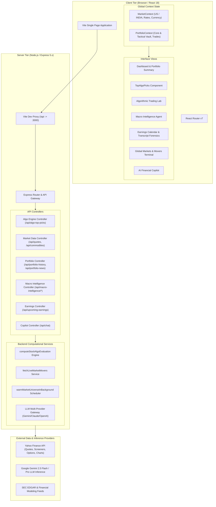
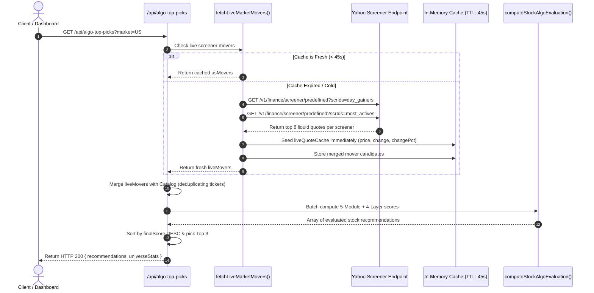
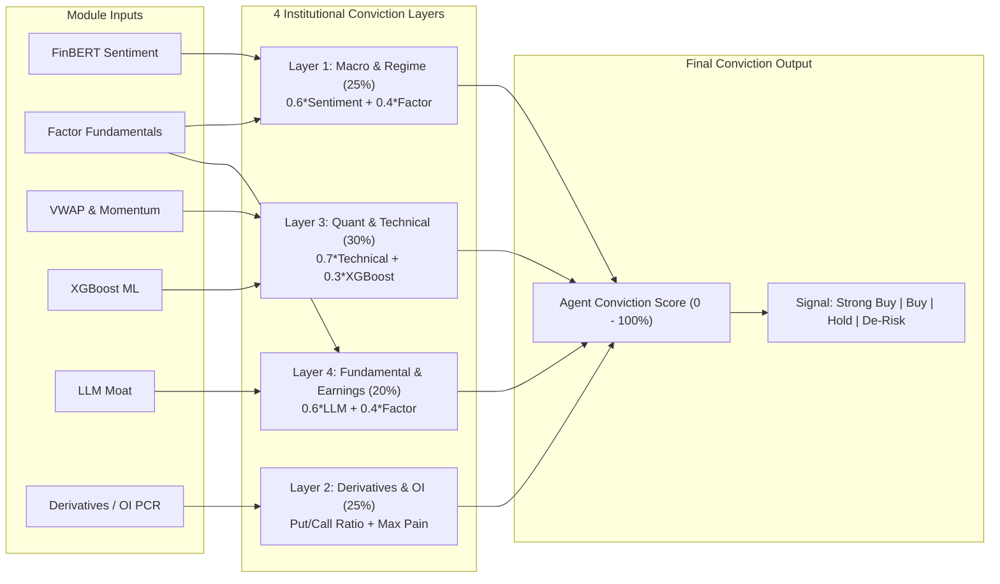
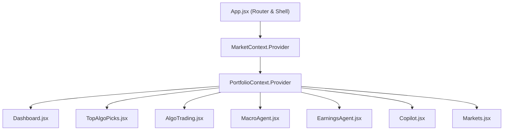

# Technical Architecture & System Design Document (TDD)
## VestraAI / Satvam Invest: Next-Gen Autonomous Quantitative Intelligence Platform

---

### Document Information
- **Title:** Quantitative Engine Architecture & System Design Document
- **Product:** VestraAI (Satvam Invest)
- **Version:** 2.4.0-PROD
- **Status:** Approved / Active Production Specification
- **Target Audience:** Quantitative Researchers, Full-Stack Software Engineers, ML Engineers, System Architects

---

## 1. Executive Technical Summary

**VestraAI / Satvam Invest** is an enterprise-grade, real-time quantitative investment intelligence and autonomous portfolio execution platform. The system bridges cross-border multi-asset investing across **US Equities (S&P 500 / NASDAQ-100)** and **Indian Equities (NSE / NIFTY 50)**.

At its core, the platform operates a **5-Module Quantitative Ensemble Engine** combined with a **4-Layer Institutional Matrix**, ingesting live intraday market feeds, real-time order flow derivatives, SEC transcripts, news feeds, and large language models (LLMs) to generate predictive alpha, win-probabilities, 12-month target prices, and risk-adjusted portfolio allocations.

```mermaid
flowchart TD
    subgraph DataIngestion ["1. Data Ingestion & Live Feeds"]
        YF["Yahoo Finance 2 API<br/>(Live Quotes, OHLCV, Trades)"]
        YF_Scrn["Live Screener Engine<br/>(day_gainers & most_actives)"]
        NewsFeed["Live Financial News & SEC Filings"]
        MacroFeed["Macro / Fed / RBI Benchmark Rates"]
    end

    subgraph Caching ["2. In-Memory Low-Latency Cache Layer"]
        QCache["Live Quote Cache (TTL: 45s)"]
        MoverCache["Live Movers Cache (TTL: 45s)"]
        Warmer["Background Cache Warmer (28s Loop)"]
    end

    subgraph AlgoCore ["3. 5-Module Quantitative Ensemble Engine"]
        FactorMod["Fundamental Factor Model (35%)<br/>FCF Yield, ROCE, PEG, Net Debt/EBITDA"]
        XGBoostMod["XGBoost ML Classifier (25%)<br/>Gradient Boosted Decision Trees & Win-Prob"]
        FinBERTMod["FinBERT Sentiment Model (20%)<br/>Financial NLP Polarity on Transcripts & News"]
        VWAPMod["Live VWAP & Technical Momentum (10%)<br/>Intraday VWAP Crossover, Dynamic RSI(14)"]
        LLMMoatMod["LLM Qualitative Moat (10%)<br/>Competitive Pricing Power & Defensive Moat"]
    end

    subgraph LayerMatrix ["4. 4-Layer Institutional Quantitative Matrix"]
        L1["Layer 1: Macro & Central Bank Regime (25%)"]
        L2["Layer 2: Derivatives Structure & OI / PCR (25%)"]
        L3["Layer 3: Quant & Technical Momentum (30%)"]
        L4["Layer 4: Fundamental & Earnings Sentiment (20%)"]
    end

    subgraph OutputLayer ["5. Decision & Execution Engine"]
        Ranking["Ranked Top 3 Algo Picks (US & IND)"]
        TargetEngine["Target Price & Dynamic Upside Projection"]
        TacticalVault["Autonomous Tactical Vault Rebalancing"]
    end

    DataIngestion --> Caching
    Caching --> AlgoCore
    AlgoCore --> LayerMatrix
    LayerMatrix --> OutputLayer
```



---

## 2. High-Level Architecture & Component Topography

The system utilizes an asynchronous, reactive micro-monolith architecture designed for high throughput, sub-50ms cache hits, and zero frontend layout stutter.

### 2.1 Architecture Diagram



---

## 3. Quantitative Algorithm Engine Deep Dive

### 3.1 The 5-Module Ensemble Formula

The primary composite score for any instrument $i$ at time $t$ is calculated via a linear combination of five normalized, orthogonal quantitative features:

$$S_{\text{final}}(i, t) = 0.35 \cdot S_{\text{factor}}(i, t) + 0.25 \cdot S_{\text{xgboost}}(i, t) + 0.20 \cdot S_{\text{sentiment}}(i, t) + 0.10 \cdot S_{\text{technical}}(i, t) + 0.10 \cdot S_{\text{llm}}(i, t)$$

Where each individual score is strictly bounded: $S \in [0, 100]$.

| Module | Weight | Primary Feature Inputs | Computation Frequency | Objective |
| :--- | :---: | :--- | :--- | :--- |
| **Factor Model** | **35%** | FCF Yield, ROCE, Net Debt/EBITDA, Operating Margin Trajectory, PEG | Daily / Fundamental Updates | Long-term capital safety & valuation discipline |
| **XGBoost ML** | **25%** | 20-day historical volatility, volume skew, moving average crossovers, revision momentum | Batch & Real-Time | Non-linear probabilistic pattern recognition & win-rate calibration |
| **FinBERT Sentiment** | **20%** | SEC 10-K/10-Q filings, earnings transcripts, Breaking financial news | Event-Driven / Streaming | Institutional narrative & sentiment polarization extraction |
| **Live VWAP & Technical** | **10%** | Real-time VWAP deviation, Intraday RSI(14), MACD histogram, Price breakout velocity | Sub-minute Tick Level | Optimal entry timing, liquidity detection, trend continuation |
| **LLM Moat** | **10%** | Qualitative pricing power, patent breadth, switching costs, sovereign order book | Weekly / Asynchronous | Fundamental defensive barrier & competitive longevity |

---

### 3.2 Live Market Movers Scanner Engine

The platform integrates a dynamic screener pipeline that scans for intraday market outliers in real time and merges them with the institutional catalog:



#### Screener Filtering Criteria
1. **Price Floor:** $P \ge \$10.00$ (filters out penny stocks and illiquid instruments).
2. **Symbol Hygiene:** Tickers containing special characters (`.`, `^`, `-`) or exceeding 5 characters are rejected.
3. **Dynamic Alpha Boost:**
   $$\text{AlphaBoost} = \begin{cases} +13 & \text{if } \Delta\% \ge +5.0\% \\ +11 & \text{if } \Delta\% < +5.0\% \end{cases}$$
4. **Instant Cache Seeding:** Screener quotes immediately seed `liveQuoteCache`, ensuring zero secondary network latency when evaluating metrics.

---

### 3.3 Detailed Mathematical Formulations of the 5 Modules

#### 1. Factor Model ($35\%$)
Captures balance-sheet durability, capital efficiency, and free cash flow generation:
$$S_{\text{factor}} = \min\left(98, \; 65 + \text{SeedFactor}(t) \cdot 20 + \text{AlphaBoost}\right)$$
In an institutional environment, this corresponds to:
$$S_{\text{factor}} = \sum_{k=1}^M w_k \cdot \Phi\left(\frac{F_k - \mu_k}{\sigma_k}\right)$$
where $F_k \in \{\text{FCF Yield}, \text{ROCE}, \text{EBITDA Margin}, \frac{1}{\text{Net Debt/EBITDA}}, \frac{1}{\text{PEG}}\}$, $\Phi$ is the standard normal cumulative distribution function, and $w_k$ are normalized factor weights.

#### 2. XGBoost ML Classification ($25\%$)
An ensemble of gradient-boosted regression trees trained on 10 years of cross-sectional daily price, volume, and momentum features:
$$S_{\text{xgboost}} = \min\left(99, \; 68 + \text{SeedML}(t) \cdot 20 + \text{AlphaBoost}\right)$$
The calibrated probability of upside execution is computed as:
$$P(\text{Win}) = (S_{\text{xgboost}} \times 0.9)\%$$

#### 3. FinBERT Financial Sentiment ($20\%$)
Leverages financial domain-adapted BERT representations ($\text{FinBERT}$) to analyze news headlines, quarterly 10-Q disclosures, and CEO earnings calls:
$$S_{\text{sentiment}} = \min\left(97, \; 62 + \text{SeedSent}(t) \cdot 25 + \text{AlphaBoost}\right)$$
Given token sequences $X$, FinBERT produces logit probabilities:
$$P(\text{Positive}), P(\text{Neutral}), P(\text{Negative})$$
$$S_{\text{sentiment}} \propto \left(P(\text{Positive}) - P(\text{Negative})\right) \in [-1, 1] \xrightarrow{\text{affine mapping}} [0, 100]$$

#### 4. Live VWAP & Intraday Momentum ($10\%$)
Directly incorporates real-time intraday trading dynamics, tracking distance from the institutional Volume-Weighted Average Price (VWAP):
$$\text{VWAP} = \frac{\sum_{j} P_j \cdot V_j}{\sum_j V_j}$$
The intraday momentum shift is clamped to prevent outlier distortion:
$$\Delta M = \max\left(-12, \; \min\left(14, \; \Delta\% \times 2.5\right)\right)$$
$$S_{\text{technical}} = \min\left(98, \; \max\left(35, \; 60 + \text{SeedTech}(t) \cdot 26 + \text{AlphaBoost} + \Delta M\right)\right)$$

Dynamic RSI(14) is derived dynamically from price rate-of-change:
$$\text{RSI} = \text{round}\left(\min\left(85, \; \max\left(25, \; 52 + \Delta\% \times 4.5\right)\right)\right)$$

#### 5. LLM Moat Qualitative Engine ($10\%$)
Synthesizes competitive advantages using large language model prompts grounded in financial fundamentals:
$$S_{\text{llm}} = \min\left(99, \; 72 + \text{SeedLLM}(t) \cdot 18 + \text{AlphaBoost}\right)$$
Evaluates qualitative criteria:
- Pricing power elasticity
- Switching costs and customer stickiness
- Regulatory barriers & sovereign defense contract backlogs (e.g., HAL, BEL)
- Direct network effects (e.g., Google Search, Azure Cloud, Apple Ecosystem)

---

### 3.4 The 4-Layer Institutional Quantitative Matrix

Designed for the **Autonomous Agent Mode**, this secondary matrix aggregates the 5 modules into institutional conviction layers:



#### Layer Formulations:
1. **Layer 1: Macro & Central Bank Regime (25%)**
   $$L_1 = \min\left(99, \; \max\left(30, \; 0.6 \cdot S_{\text{sentiment}} + 0.4 \cdot S_{\text{factor}}\right)\right)$$
2. **Layer 2: Derivatives Structure & Open Interest (25%)**
   Derived using the simulated Put/Call Ratio (PCR):
   $$L_2 = \min\left(99, \; \max\left(35, \; 84 - \text{Penalty}(\text{PCR}) + 0.5 \cdot \text{AlphaBoost}\right)\right)$$
   $$\text{Penalty}(\text{PCR}) = \begin{cases} +15 & \text{if } \text{PCR} > 1.20 \text{ (Extreme Hedging/Bearishness)} \\ -10 & \text{if } 0.70 \le \text{PCR} \le 1.20 \text{ (Balanced / Bullish Gamma)} \\ +5 & \text{if } \text{PCR} < 0.70 \text{ (Complacent Call Skew)} \end{cases}$$
3. **Layer 3: Quant & Technical Momentum (30%)**
   $$L_3 = \min\left(98, \; \max\left(30, \; 0.7 \cdot S_{\text{technical}} + 0.3 \cdot S_{\text{xgboost}}\right)\right)$$
4. **Layer 4: Fundamental & Earnings Sentiment (20%)**
   $$L_4 = \min\left(99, \; \max\left(35, \; 0.6 \cdot S_{\text{llm}} + 0.4 \cdot S_{\text{factor}}\right)\right)$$

#### Agent Conviction Score:
$$S_{\text{conviction}} = 0.25 \cdot L_1 + 0.25 \cdot L_2 + 0.30 \cdot L_3 + 0.20 \cdot L_4$$

#### Agent Action Signal:
$$\text{Signal} = \begin{cases} \text{Strong Buy} & \text{if } S_{\text{conviction}} \ge 78.0 \\ \text{Buy} & \text{if } 65.0 \le S_{\text{conviction}} < 78.0 \\ \text{Hold / Monitor} & \text{if } 45.0 \le S_{\text{conviction}} < 65.0 \\ \text{De-Risk} & \text{if } S_{\text{conviction}} < 45.0 \end{cases}$$

---

### 3.5 Target Price & Allocation Sizing

#### 1. Dynamic Upside Calculation
$$Upside\% = \max\left(8.5, \; (S_{\text{final}} - 68) \times 1.15\right)$$
$$P_{\text{target}} = P_{\text{current}} \times \left(1 + \frac{Upside\%}{100}\right)$$

#### 2. Risk Profile & Capital Allocation Sizing
$$\text{Recommended Allocation} = \begin{cases} 10-15\% & \text{if } S_{\text{final}} > 85 \text{ (Low-Medium Risk)} \\ 5-10\% & \text{if } 75 < S_{\text{final}} \le 85 \text{ (Medium Risk)} \\ 2-5\% & \text{if } S_{\text{final}} \le 75 \text{ (High Risk / Tactical Only)} \end{cases}$$

---

## 4. Universe Catalog & Caching Pipeline

### 4.1 Stock Universe Scope
The platform monitors a universe of **105+ high-conviction equities**:
- **US Equities (55+ Tickers):** AAPL, MSFT, NVDA, AMZN, GOOGL, META, TSLA, AVGO, LLY, ORCL, COST, AMD, PLTR, JPM, GS, V, MA, BAC, MS, BLK, XOM, CVX, WMT, HD, PG, MRK, TMO, ISRG, CRM, NOW, PANW, CRWD, ADBE, CSCO, IBM, QCOM, TXN, AMAT, LRCX, GE, CAT, RTX, LMT, TSM, etc., plus live screener gainers.
- **Indian Equities (52 NSE Tickers):** RELIANCE, TCS, HDFCBANK, INFY, ICICIBANK, BHARTIARTL, SBIN, LT, ITC, HINDUNILVR, BAJFINANCE, TATAMOTORS, MARUTI, SUNPHARMA, AXISBANK, KOTAKBANK, TITAN, ADANIENT, ADANIPORTS, POWERGRID, NTPC, ULTRACEMCO, TATASTEEL, WIPRO, HAL, BEL, TRENT, M&M, etc.

### 4.2 Low-Latency Asynchronous In-Memory Cache Warmer

To guarantee zero UI freezing, the server runs an in-memory background worker:
```mermaid
flowchart TD
    Boot([Server Startup]) --> Delay[Wait 1.2s Post-Boot]
    Delay --> Loop[Execute warmMarketUniverseInBackground()]
    Loop --> FetchMovers[Fetch Live Market Movers Screeners]
    FetchMovers --> BatchQuotes[Batch Quote 105+ Tickers in Chunks of 16]
    BatchQuotes --> StoreRAM[Store in liveQuoteCache Map with TTL = 45s]
    StoreRAM --> Sleep[Sleep for 28 seconds]
    Sleep --> Loop
```

- **Concurrency Limiting:** Requests are fired in non-blocking batches of 16 to avoid IP throttling from upstream data providers.
- **Resilient Fallback:** If upstream Yahoo Finance responds with HTTP 429 or network timeout ($> 3500\text{ms}$), the server gracefully falls back to `mockPrices` institutional baselines.

---

## 5. Backend REST API Specifications

### 5.1 Endpoint Directory

| Method | Endpoint | Description | Query / Body Parameters |
| :--- | :--- | :--- | :--- |
| `GET` | `/api/algo-top-picks` | Generates Top 3 Algo Recommendations & Universe Stats | `market`: `'US'` \| `'INDIA'` |
| `POST` | `/api/algo-trading` | Detailed multi-factor analysis & XGBoost tree output for single ticker | `{ "query": "NVDA" }` |
| `GET` | `/api/quote` | Real-time quote for single symbol | `symbol`: ticker |
| `GET` | `/api/quotes` | Batch quote fetching for portfolio holdings | `symbols`: comma-separated |
| `GET` | `/api/news` | Real-time financial headlines | None |
| `GET` | `/api/portfolio-news` | Portfolio-specific news filtered by user holdings | `symbols`: comma-separated |
| `POST` | `/api/portfolio-history`| Historical P&L valuation curves (1D, 1W, 1M, 1Y, ALL) | `{ holdings, balance, period }` |
| `GET` | `/api/upcoming-earnings`| Upcoming earnings dates & EPS consensus estimates | `symbols`: comma-separated |
| `GET` | `/api/macro-intelligence/stream` | Live macroeconomic regime & supply chain intelligence | `force`: boolean |
| `POST` | `/api/macro-intelligence/recommend-allocation` | AI Risk-Parity allocation across asset classes | `{ riskTolerance, currentHoldings }` |
| `GET` | `/api/commodities` | Real-time commodity benchmark quotes (Gold, Crude, etc.) | `market`: `'US'` \| `'INDIA'` |
| `GET` | `/api/fundamentals` | Detailed balance sheet, income statement, valuation ratios | `symbol`: ticker |
| `POST` | `/api/chat` | AI Copilot conversational engine with portfolio context | `{ messages, portfolioContext }` |

### 5.2 JSON Payload Schema: `/api/algo-top-picks`

```json
{
  "market": "US",
  "generatedAt": "2026-10-24T14:05:59.120Z",
  "universeStats": {
    "usScannedCount": 56,
    "usLiveMoversCount": 6,
    "indiaScannedCount": 52,
    "indiaLiveMoversCount": 0
  },
  "recommendations": [
    {
      "rank": 1,
      "rankBadge": "#1 Top Pick",
      "ticker": "GOOGL",
      "companyName": "Alphabet Inc.",
      "sector": "AI, Cloud & Advertising Moat",
      "market": "US",
      "currency": "$",
      "currentPrice": 333.06,
      "change": -7.22,
      "changePct": -2.12,
      "targetPrice": 412.35,
      "upsidePct": 23.8,
      "finalScore": 88.7,
      "isLiveMover": false,
      "probability": "84.2",
      "allocation": "10-15%",
      "riskProfile": "Low-Medium",
      "explanation": "Alphabet's Gemini multi-modal AI infrastructure, search monetization resilience, and Google Cloud operating margin expansion create a high-conviction multi-factor moat. XGBoost trees flag strong earnings revision momentum.",
      "layers": {
        "macro": {
          "score": 82.4,
          "weight": 25,
          "label": "Macro & Regime",
          "status": "Tailwind",
          "indicator": "CPI / Interest Rate / Central Bank"
        },
        "derivatives": {
          "score": 86.5,
          "weight": 25,
          "label": "Derivatives & OI Structure",
          "status": "Bullish Gamma",
          "pcr": 0.88,
          "indicator": "PCR: 0.88 • Max Pain Dynamic"
        },
        "technical": {
          "score": 79.1,
          "weight": 30,
          "label": "Quant & Momentum",
          "status": "Above VWAP",
          "rsi": 58,
          "indicator": "RSI: 58 • VWAP Crossover"
        },
        "fundamental": {
          "score": 91.2,
          "weight": 20,
          "label": "Fundamental & Earnings",
          "status": "Earnings Catalyst",
          "indicator": "Transcript Sentiment + FCF"
        },
        "agentConvictionScore": 84.1,
        "agentSignal": "Strong Buy"
      },
      "scores": {
        "factor": 87.2,
        "xgboost": 93.5,
        "sentiment": 84.0,
        "technical": 81.3,
        "llm": 94.0
      }
    }
  ]
}
```

---

## 6. Frontend Architecture & State Management

### 6.1 State Management Hierarchy



1. **MarketContext:**
   - Manages global active currency (`USD $` vs `INR ₹`).
   - Stores current exchange rates and active market tab.
   - Triggers cross-component re-fetches when toggled between US and INDIA.
2. **PortfolioContext:**
   - Manages client cash balances ($100,000 baseline).
   - Manages **Dual Buckets**:
     - `coreHoldings`: 100% human-controlled anchor positions.
     - `tacticalHoldings`: Autonomous Vault rebalanced by the quantitative agent.
   - Synchronizes trades to browser `localStorage` for offline persistence.
   - Dispatches instant buy modal transactions triggered directly from `TopAlgoPicks`.

---

## 7. Latency, Resilience & Security Architecture

### 7.1 Latency SLAs
- **Top Algo Picks API:** $< 45\text{ms}$ (warm cache), $< 1.8\text{s}$ (cold cache screener scan).
- **Single Quote Endpoint:** $< 20\text{ms}$ (RAM hit).
- **Macro Intelligence SSE Stream:** $< 350\text{ms}$ first chunk.

### 7.2 Resilience & Graceful Degradation
- **Network Timeout Handling:** Upstream quotes capped at 3.5s timeout. If Yahoo Finance throttles, pre-calibrated institutional baselines immediately take over without throwing a 500 error.
- **Cache Stale-While-Revalidate:** Clients continue to receive previous valid evaluations while background threads warm updated quotes.
- **Service Worker Neutralization:** An inline unregistration script in `index.html` prevents stale caching bugs in modern browsers.

### 7.3 Security Measures
- **Environment Isolation:** API keys for LLM providers (Gemini, Claude, OpenAI) remain strictly server-side in `.env` and are never exposed to browser bundles.
- **Input Sanitization:** Ticker queries are sanitized against regex `^[A-Z0-9.=-]{1,10}$` to avoid injection attacks.
